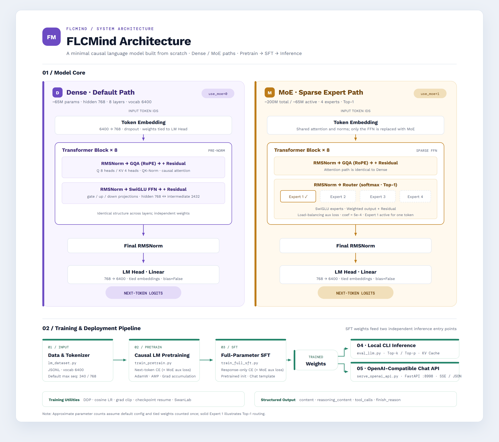

# FLCMind

English | [中文](README.zh.md)

A minimal, runnable large language model project built **for learning**, covering the full pipeline: **pretraining → SFT fine-tuning → deployment**.

- A Llama-style architecture implemented from scratch (RMSNorm / RoPE / GQA / SwiGLU), with optional **MoE (Mixture of Experts)** support.
- The tokenizer, training data and trained weights are all ready — follow the steps below to run the whole pipeline.
- Deployment ships an **OpenAI-compatible API**, callable directly with the `openai` client.



---

## Project structure

```
flcmind/
├── model/                        # Model definition and tokenizer
│   ├── model_flcmind.py          #   FLCMind architecture (Config / ForCausalLM)
│   ├── tokenizer.json            #   Tokenizer (vocab 6400)
│   └── tokenizer_config.json
├── dataset/                      # Data loaders and training data (download data from HF, see below)
│   ├── lm_dataset.py             #   PretrainDataset / SFTDataset
│   ├── pretrain_t2t_mini.jsonl   #   Pretraining data (~1.2GB, extracted from pretrain_t2t_mini.7z)
│   └── sft_t2t_mini.jsonl        #   SFT dialogue data (~1.7GB, extracted from sft_t2t_mini.7z)
├── trainer/                      # Training scripts
│   ├── train_pretrain.py         #   Pretraining
│   ├── train_full_sft.py         #   Full-parameter SFT
│   └── trainer_utils.py          #   Shared utilities (model init, checkpoints, etc.)
├── scripts/
│   └── serve_openai_api.py       # OpenAI-compatible API server
├── out/                          # Trained weights (download from HF, see below)
│   ├── full_sft_768.pth          #   Dense SFT weights (chat) ★ recommended for deployment
│   └── moe_sft_768_moe.pth       #   MoE SFT weights (chat)
├── checkpoints/                  # Resume-training checkpoints
├── flcmind-architecture/         # Architecture diagram
├── eval_llm.py                   # Command-line inference
└── requirements.txt              # Dependencies
```

---

## Setup

```bash
pip install -r requirements.txt
# Also install the torch build matching your CUDA version (not pinned in requirements):
# pip install torch==2.6.0
```

A CUDA GPU (≥6GB VRAM) is required. For inference only you can pass `--device cpu`, but it is much slower.

---

## Getting data and weights (Hugging Face)

Training data and trained weights are published on Hugging Face. This repository does not include these large files — download them before the first run.

- Dataset: https://huggingface.co/datasets/FLCgeigeigei/flcmind-datasets
- Model weights: https://huggingface.co/FLCgeigeigei/flcmind

```bash
pip install -U huggingface_hub

# 1) Dataset: download archives → extract into dataset/
hf download FLCgeigeigei/flcmind-datasets --repo-type dataset --local-dir dataset
7z x dataset/pretrain_t2t_mini.7z -odataset
7z x dataset/sft_t2t_mini.7z -odataset

# 2) Model weights: download → put into out/
hf download FLCgeigeigei/flcmind --repo-type model --local-dir hf_model
cp hf_model/full_sft_768.pth hf_model/moe_sft_768_moe.pth out/
```

- **Just want to chat without training**: only step 2 is needed.
- The model repo also ships `model_flcmind.py` and `tokenizer*.json`, identical to the files under `model/` — no need to overwrite.
- Extraction requires [7-Zip](https://www.7-zip.org/). If your network is restricted, set a proxy first, e.g. `set HTTPS_PROXY=http://127.0.0.1:7890` (PowerShell: `$env:HTTPS_PROXY="http://127.0.0.1:7890"`).

---

## ⚠️ Important: scripts use relative paths — run them from their own directory

Every script treats its own directory as the working directory and reaches sibling `model/`, `out/` and `dataset/` via `../`.
**So `cd trainer` before training and `cd scripts` before deployment**, otherwise you will get a "cannot find ../model" error.
(`eval_llm.py` is run from the project root.)

---

## Quick start (with downloaded weights)

After downloading the SFT weights into `out/` as described above, you can skip training and chat directly:

```bash
cd scripts
python serve_openai_api.py --weight full_sft     # start the OpenAI-compatible server
```

Or skip the server and chat from the command line:

```bash
python eval_llm.py --weight full_sft             # run from the project root
```

> To try the **MoE variant**: `python serve_openai_api.py --use_moe 1 --weight moe_sft` (download `out/moe_sft_768_moe.pth` first — see "MoE architecture" below).

---

## 1. Pretraining

Teaches the model to "continue text" and gives it basic language ability.

```bash
cd trainer
python train_pretrain.py                          # default data, writes ../out/pretrain_768.pth
```

- Data defaults to `../dataset/pretrain_t2t_mini.jsonl`
- The weight prefix is set via `--save_weight`, e.g. `--save_weight mymodel` → `out/mymodel_768.pth`
- Resume training: `python train_pretrain.py --from_resume 1`

> Pretraining weights are an **intermediate artifact** and can be deleted once SFT is done (`out/` should only keep the final SFT weights used for deployment).

## 2. SFT fine-tuning

Continues from the pretrained weights so the model learns to hold a conversation.

```bash
cd trainer
python train_full_sft.py --from_weight pretrain --save_weight full_sft
```

- Continues from the pretrained weights `pretrain_768.pth`
- Data defaults to `../dataset/sft_t2t_mini.jsonl`
- Writes `../out/full_sft_768.pth`

> If you already downloaded `out/full_sft_768.pth`, you can skip this step.

## 3. Deployment and inference

```bash
cd scripts
python serve_openai_api.py --weight full_sft      # deploy the chat model (recommended)
# add --device cpu if you have no GPU
```

The server listens on `http://0.0.0.0:8998` and exposes an OpenAI-compatible API.

### Test the API

curl:

```bash
curl http://localhost:8998/v1/chat/completions \
  -H "Content-Type: application/json" \
  -d '{"model":"flcmind-local:latest","messages":[{"role":"user","content":"Hello"}],"temperature":0.7}'
```

Python client (streaming):

```python
from openai import OpenAI
client = OpenAI(api_key="sk-any", base_url="http://localhost:8998/v1")
resp = client.chat.completions.create(
    model="flcmind-local:latest",
    messages=[{"role": "user", "content": "Hello"}],
    temperature=0.7,
    stream=True,
)
for chunk in resp:
    print(chunk.choices[0].delta.content or "", end="")
```

### Command-line inference (no server)

```bash
python eval_llm.py --weight full_sft
```

---

## MoE architecture (optional)

Besides the default dense model, this project also supports **MoE (Mixture of Experts)**: each layer's feed-forward network (FFN) is replaced by several "experts", and a gate network dynamically picks the Top-K experts for each token.

**Core idea**: "sparse activation" decouples **parameter count** from **compute** — each token goes through only 1 expert (Top-1), so model capacity grows a lot while inference cost stays essentially unchanged.

| | Dense | MoE (4 experts, Top-1) |
|---|---|---|
| Total parameters (VRAM/size) | ~65M (`~131MB`) | ~200M (`~400MB`) |
| Active parameters (per token) | ~65M | **~65M** (non-FFN fully active + only 1 expert) |
| Compute per token | 1× | ≈1× (almost identical) |

> In one sentence: MoE trades "more VRAM/storage" for "more model capacity" while per-token compute barely changes. It therefore competes with **dense models of the same parameter count** (several times cheaper in compute), not with a single small dense model. The more data and the more frequent the inference, the better the payoff; for this project (small model + small data), MoE is mainly for **learning how it works**.

### Enabling it

All scripts use `--use_moe 1` (default `0` = dense). When enabled, weight filenames automatically get a **`_moe` suffix** (e.g. `pretrain_768_moe.pth`) to distinguish the two kinds of weights.

> ⚠️ **Training, SFT, deployment and inference must all use the same `--use_moe` value**, otherwise loading fails due to shape mismatches.

> ✅ If you already downloaded `out/moe_sft_768_moe.pth` (chat), jump straight to step 3 below: `python serve_openai_api.py --use_moe 1 --weight moe_sft`.

```bash
# 1. Pretraining (MoE)
cd trainer
python train_pretrain.py --use_moe 1 --save_weight pretrain
#   → ../out/pretrain_768_moe.pth

# 2. SFT (MoE) — --from_weight takes the pretraining prefix
python train_full_sft.py --use_moe 1 --from_weight pretrain --save_weight full_sft
#   → ../out/full_sft_768_moe.pth

# 3. Deployment (MoE)
cd ../scripts
python serve_openai_api.py --use_moe 1 --weight full_sft

# 4. Command-line inference (MoE)
python eval_llm.py --use_moe 1 --weight full_sft
```

> The weight prefix follows `--save_weight`. For example `--save_weight moe_model` produces `moe_model_768_moe.pth`, and later `--from_weight` / `--weight` must use that same prefix `moe_model`.

**Complete example (custom prefixes, must line up across all three steps):**

```bash
# 1) Pretraining: choose prefix moe_model
cd trainer
python train_pretrain.py --use_moe 1 --save_weight moe_model
#   → ../out/moe_model_768_moe.pth

# 2) SFT: --from_weight uses the prefix from 1), --save_weight picks a new prefix moe_sft
python train_full_sft.py --use_moe 1 --from_weight moe_model --save_weight moe_sft
#   → ../out/moe_sft_768_moe.pth

# 3) Deployment: --weight uses the prefix from 2) moe_sft
cd ../scripts
python serve_openai_api.py --use_moe 1 --weight moe_sft
```

> ⚠️ Do **not** set SFT's `--save_weight` to the pretraining prefix, or you will overwrite the pretrained weights (same filename). The relationship is: pretraining produces → SFT reads it and produces a new prefix → deployment reads the SFT prefix.

### Multi-GPU training (DDP)

The training scripts support `torchrun` data parallelism (deployment/inference does not need it — a single GPU is fine):

```bash
cd trainer
torchrun --nproc_per_node=2 train_pretrain.py --use_moe 1 --save_weight pretrain
torchrun --nproc_per_node=2 train_full_sft.py --use_moe 1 --from_weight pretrain --save_weight full_sft
```

- `--nproc_per_node` = number of GPUs; to pick specific GPUs, prefix `CUDA_VISIBLE_DEVICES=0,1`.
- **`--batch_size` is "per GPU" and should not be changed**. But the effective batch scales with GPU count:
  `effective batch = batch_size × num_gpus × accumulation_steps` (default `32 × num_gpus × 8`).
  To keep behavior identical to single-GPU, reduce `--accumulation_steps` proportionally.
- ⚠️ **Windows does not support NCCL** (the scripts default to `backend="nccl"`). Multi-GPU on Windows often fails; single-GPU training is recommended.

### Configuration

MoE hyperparameters live in `FLCMindConfig` in `model/model_flcmind.py` (all ignored when `use_moe=False`):

| Option | Default | Description |
|--------|---------|-------------|
| `num_experts` | 4 | Total number of experts (more = more parameters/capacity) |
| `num_experts_per_tok` | 1 | Experts activated per token (Top-K); setting 2 doubles active params and compute |
| `moe_intermediate_size` | same as `intermediate_size` | Intermediate size of a single expert FFN |
| `norm_topk_prob` | True | Whether to normalize the Top-K gate weights |
| `router_aux_loss_coef` | 5e-4 | Load-balancing auxiliary loss coefficient (prevents uneven expert usage) |

> Training logs print `logits_loss` (language modeling loss) and `aux_loss` (load-balancing loss) separately; their sum is the total loss.

---

## Benchmarks

All numbers below were measured on a single RTX 4090 in fp16, with **identical prompts and an identical scoring rule for every model** — the baselines were run under the same protocol, not copied from vendor cards.

| Model | Params (total / active) | C-Eval 5-shot | CMMLU 5-shot | PPL↓ | Decode (tok/s) | VRAM (GB) |
|---|---|---|---|---|---|---|
| **FLCMind-Dense-SFT** | 63.9M | 26.3 ± 2.3 | 24.7 ± 2.3 | 170.8 | 161 | 0.2 |
| **FLCMind-MoE-SFT** | 198.4M / 63.9M | 25.2 ± 2.3 | 23.8 ± 2.3 | **112.2** | 111 | 0.4 |
| GPT2-Chinese-Distil-60M‡ | 59.5M | 23.0 ± 2.2 | 24.4 ± 2.3 | — | 398 | 0.2 |
| GPT2-Chinese-102M‡ | 102.1M | 23.0 ± 2.2 | 24.4 ± 2.3 | — | 242 | 0.3 |
| Wenzhong-GPT2-110M‡ | 124.5M | 27.9 ± 2.4 | 24.6 ± 2.3 | — | 218 | 0.4 |
| SmolLM2-135M§ | 134.5M | 22.7 ± 2.2 | 25.0 ± 2.3 | — | 68 | 0.3 |
| GPT-2 Medium§ | 354.8M | 27.0 ± 2.4 | 24.1 ± 2.3 | — | 125 | 0.9 |
| SmolLM2-360M§ | 361.8M | 24.4 ± 2.3 | 23.8 ± 2.3 | — | 62 | 0.8 |
| TinyLlama-1.1B§ | 1.10B | 24.3 ± 2.3 | 24.2 ± 2.3 | — | 87 | 2.1 |
| SmolLM2-1.7B§ | 1.71B | 33.2 ± 2.5 | 32.8 ± 2.5 | — | 85 | 3.5 |

> C-Eval: n = 1346 (full val), 5-shot, completion template. CMMLU: n = 1340 (test, 20 per subject). ± = half-width of the Wilson 95% CI. PPL is computed per token on C-Eval prompts and is only comparable between models sharing a tokenizer. § English-dominant model. ‡ `BertTokenizer`-based: cannot encode `A/B/C/D` as single tokens, so the score is a floor — GPT2-Chinese predicts one fixed letter 100% of the time, and its accuracy is just that letter's share of the gold answers.

Four-way random guessing is 25.0%; every model in the 60–135M range lands in 22–28%, i.e. they are statistically indistinguishable.

MoE pays off in language modelling rather than in answering: with the same active parameters PPL drops 34% (170.8 → 112.2) while C-Eval stays flat, and decode throughput falls from 161 to 111 tok/s.

**Throughput** (one 128-token prompt replicated into a batch, 32 tokens decoded):

| Model | Prefill tok/s (bs1 / bs32) | Decode tok/s (bs1 / bs32) |
|---|---|---|
| FLCMind-Dense-SFT | 20,477 / 548,127 | 163 / 4,910 |
| FLCMind-MoE-SFT | 10,449 / 302,191 | 106 / 3,048 |
| GPT2-Chinese-Distil-60M | 51,507 / 1,427,555 | 393 / 11,400 |

A single request cannot saturate a 4090 — batching 32 requests raises decode throughput about 30×. FLCMind is ~2.5× slower than a same-size GPT-2 baseline because its attention is plain PyTorch rather than a fused SDPA kernel; that is an implementation gap, not a capability one.

**MoE routing load** (first 64 C-Eval prompts): expert share 24.6 / 24.8 / 23.7 / 27.0% (ideal 25%), overall max/min load ratio 1.14 (per-layer 1.40–2.31), normalized routing entropy 0.96–0.995 — no expert collapse, though the high entropy also means experts are not strongly specialised.

---

## Common pitfalls

| Symptom | Cause | Fix |
|---------|-------|-----|
| `HFValidationError: ... '../model'` | Not run from the script's directory | `cd trainer` or `cd scripts` first |
| `CUDA error: device-side assert` | `temperature=0.0` in the request; forced sampling divides by zero | Set a positive temperature on the client (e.g. 0.7) and **restart the server** to clear the polluted CUDA context |
| Garbled output / random continuations | Using the `pretrain` weights | Deploy with `--weight full_sft` |
| Weight shape mismatch when loading | Launch flags differ from training | `--hidden_size` / `--num_hidden_layers` / `--use_moe` must match training (defaults: 768 / 8 / off) |
| MoE weights fail to load / not found | Forgot `--use_moe 1`, or wrong `--weight` prefix | Keep `--use_moe` consistent; `--weight` takes a **prefix**, the script appends `_768_moe.pth` |
| `torchrun` error pointing to `.../elastic/errors.html` | Windows lacks NCCL support (scripts default to `backend="nccl"`) | Use single-GPU `python ...` on Windows; multi-GPU needs Linux |

---

## Full pipeline at a glance (from scratch to API)

```bash
# 1. Pretraining
cd trainer
python train_pretrain.py --save_weight mymodel

# 2. SFT
python train_full_sft.py --from_weight mymodel --save_weight mymodel_sft

# 3. Deployment
cd ../scripts
python serve_openai_api.py --weight mymodel_sft

# 4. Test
curl http://localhost:8998/v1/chat/completions \
  -H "Content-Type: application/json" \
  -d '{"model":"flcmind","messages":[{"role":"user","content":"Hello"}],"temperature":0.7}'
```
